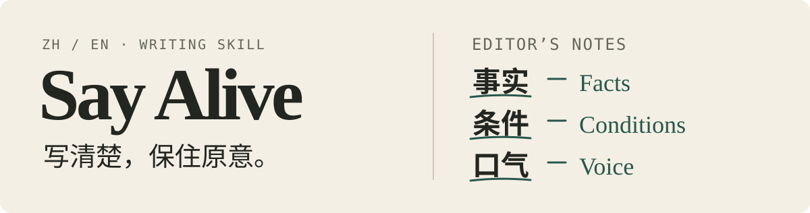

<h1></h1>

我们做 Say Alive，是想让 AI 写出读者用得上、作者也愿意署名的文字。该说的事直接说，改稿时留住事实、条件和作者的口气。它支持中英文写作、改写和审阅，适用于所有支持 Skill 的 AI Agent 和 Harness。

## 快速上手

把下面这段话发给支持 Skill 的 AI Agent 或 Harness。

```text
请帮我安装这个仓库的 Say Alive Skill，
并在以后撰写文本时使用。
https://github.com/AkkoYK/SayAlive
技能在 say-alive/ 目录。
```

## 客观盲评

出题、写稿、审稿和评分由互相隔离的 Agent 承担。每轮中英各 14 题，各组用同一模型，Say Alive 组另做一轮独立审稿。每篇终稿交给三位对应语言的模型评委，他们只看题目、评分要点和随机编号的稿件，按五项标准打分。

参与测试的模型包括 OpenAI、Anthropic、Google 等厂商的前沿模型。

### 综合排名

| 排名 | 参评组 | 版本 | 整体 | 人味 | 可读性 | 忠实与完成度 | 文体适配 |
| ---: | --- | --- | ---: | ---: | ---: | ---: | ---: |
| 1 | **Say Alive** | v0.5 | **8.81** | 8.72 | 8.95 | 9.28 | 8.96 |
| 2 | blader/humanizer | v3.1.0 | 8.59 | 8.44 | 8.81 | 9.20 | 8.78 |
| 3 | 无 Skill 基线 | — | 8.32 | 8.11 | 8.73 | 8.88 | 8.67 |
| 4 | Humanizer-zh | 2026-09-23 修订版 | 7.67 | 7.61 | 8.52 | 8.51 | 8.18 |
| 5 | shuorenhua | v2.6.0 | 7.37 | 7.31 | 8.21 | 8.45 | 7.95 |
| 6 | ASD-STE100 Skill | v0.4.0 | 6.90 | 6.53 | 7.86 | 8.38 | 7.43 |

表中各项均为十分制平均分。评委单独给出「整体」分，排名按该项均分排序。同一稿件的复评先合并，再按题等权平均。

Say Alive 采用 [MIT 许可证](LICENSE)。技能包附有[第三方署名](say-alive/LICENSE)。
